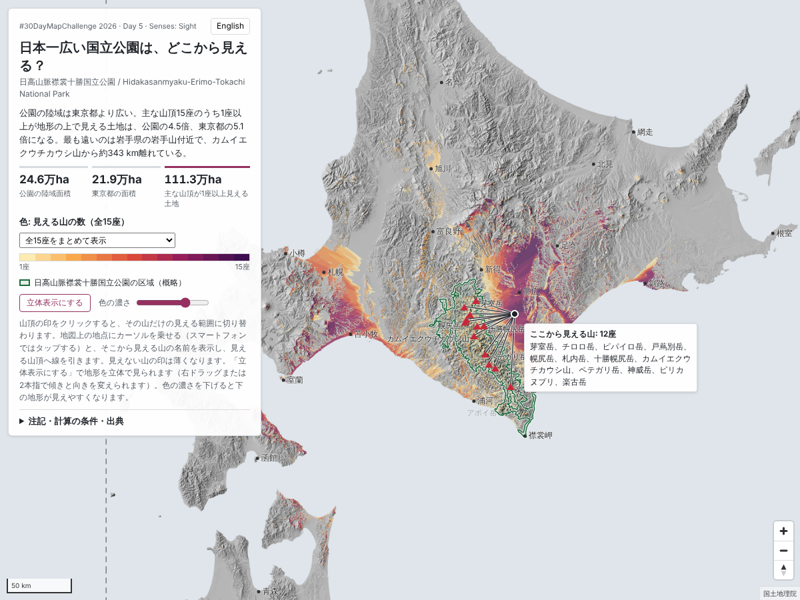

# 日本一広い国立公園は、どこから見える？

**Where can you see Japan's largest national park from?**
日高山脈襟裳十勝国立公園 / Hidakasanmyaku-Erimo-Tokachi National Park

#30DayMapChallenge 2026 Day 5「Senses: Sight」の作品です。

公開URL: https://shinyanakashima.github.io/30daymapchallenge-2026day5-hidakasanmyaku/



## 概要

日高山脈襟裳十勝国立公園は、2024年6月25日に日高山脈襟裳国定公園を拡大して、国内35か所目の国立公園として指定されました。陸域の面積は245,668 haで、国立公園として国内最大、東京都（219,405 ha）より広い公園です。

この地図は、公園の中心である日高山脈の主な山頂15座が、地形の上でどこから見えるかを計算し、見える山の数を色で示したものです。

| 項目 | 面積 |
| --- | --- |
| 公園の陸域面積 | 245,668 ha |
| 東京都の面積 | 219,405 ha |
| 主な山頂が1座以上見える土地 | 1,113,149 ha（公園の4.5倍、東京都の5.1倍） |

最も遠く見える地点は岩手県の岩手山付近で、カムイエクウチカウシ山から約343 km 離れています。見える土地のうち約2.0万 ha は本州北部にあります。

地図の操作:

- 山頂の印をクリックする（またはパネルで山を選ぶ）と、その山だけの見える範囲に切り替わります。
- 地図上の地点にカーソルを乗せる（スマートフォンではタップする）と、そこから見える山の名前を表示し、見える山頂へ線を引きます。見えない山の印は薄くなります。
- 「立体表示にする」で、地形を立体にして見えている範囲を重ねて表示します（右ドラッグまたは2本指で傾きと向きを変えられます）。高さは1.6倍に強調しています。
- 「色の濃さ」で、色の透明度を変えて下の地形を見やすくできます。
- 右上のボタンで日本語と英語を切り替えます（`?lang=en` でも指定できます）。

SNS投稿用の画像: [site/card.png](site/card.png)

## 注記

- 標高データには木や建物が含まれていないため、「地形の上で見える範囲」です。森林や建物による遮り、天気や霞は考慮していません。
- 緑の線は公園の区域（概略）です。環境省 生物多様性「見える化」マップの国立公園区域（原典: 環境省 EADAS 自然公園区域。令和6年6月25日告示の公園計画書・公園計画図・GISデータをもとに作成されたもの）から、日高山脈襟裳十勝国立公園の235区画を取得し、地種区分をまとめて1つの区域にしました。原典は区域の概要を示すもので誤差を含みます。このデータでの面積は約254,392 haで、面積の比較には環境省の公表値（陸域245,668 ha）を使っています。
- 山の英語名は、環境省の英語資料で使われている表記（Mount Apoi）に合わせ、ほかの山も同じ形式で国土地理院の読みから表記しました。

## 計算の条件

| 項目 | 値 |
| --- | --- |
| 計算方法 | GDAL `gdal_viewshed`（山頂ごとに計算し、山ごとの結果を1ビットずつ1枚のラスタにまとめた） |
| 観測点 | 各山頂の地表（国土地理院の標高値の高さ。30 m 格子の標高との差を観測点の高さとして与えた） |
| 目標の高さ | 地表から1.6 m |
| 地球の丸みと大気差の補正 | `-cc 0.85714`（屈折係数 0.13 相当） |
| 標高データ | 国土地理院 標高タイル（DEM10B 由来、PNG形式、ズーム12、約28 m 間隔）を30 m 間隔に平均 |
| 計算範囲 | 東経139.3〜146.0度、北緯39.3〜45.6度（北海道全体と東北地方北部、地図の点線の枠）。海は標高0 m として扱い、面積には含めない |
| 座標系 | JGD2011 / UTM 第54帯（EPSG:6690） |

見える土地が標高データの端（幅0.03度）に届いていないことを、山ごとに確認しています（`data/stats.json` の `edge_cells` がすべて0）。

## 使った山頂

国土地理院「日本の主な山岳標高」（2026年3月31日版、CSV）から選んだ15座です。面積は、その山が見える陸地の面積です。

| 山名 | English | 標高 (m) | 緯度, 経度 | 見える土地 (ha) | 最も遠い見える地点 (km) |
| --- | --- | ---: | --- | ---: | ---: |
| 芽室岳 | Mount Memuro | 1,753 | 42.868967, 142.785395 | 498,839 | 234.3 |
| チロロ岳 | Mount Chiroro | 1,880 | 42.825585, 142.675406 | 542,368 | 291.2 |
| ピパイロ岳 | Mount Pipairo | 1,916 | 42.773184, 142.72761 | 440,901 | 265.6 |
| 戸蔦別岳 | Mount Tottabetsu | 1,959 | 42.738665, 142.695107 | 523,689 | 262.6 |
| 幌尻岳 | Mount Poroshiri | 2,052 | 42.719435, 142.682894 | 618,417 | 289.8 |
| エサオマントッタベツ岳 | Mount Esaomantottabetsu | 1,902 | 42.689411, 142.757826 | 476,346 | 289.9 |
| 札内岳 | Mount Satsunai | 1,895 | 42.693848, 142.79675 | 430,923 | 264.1 |
| 十勝幌尻岳 | Mount Tokachi-Poroshiri | 1,846 | 42.695467, 142.859408 | 432,918 | 198.6 |
| カムイエクウチカウシ山 | Mount Kamuiekuuchikaushi | 1,979 | 42.625112, 142.766406 | 544,079 | 343.0 |
| １８３９峰 | Peak 1839 | 1,842 | 42.539346, 142.808116 | 490,087 | 336.0 |
| ペテガリ岳 | Mount Petegari | 1,736 | 42.499337, 142.871019 | 515,136 | 334.4 |
| 神威岳 | Mount Kamui | 1,600 | 42.428465, 142.906866 | 444,704 | 294.6 |
| ピリカヌプリ | Mount Pirikanupuri | 1,630 | 42.402225, 142.966802 | 529,182 | 329.0 |
| 楽古岳 | Mount Rakko | 1,471 | 42.272513, 143.111252 | 446,678 | 282.2 |
| アポイ岳 | Mount Apoi | 810 | 42.107849, 143.025658 | 65,815 | 248.6 |

## データと出典

- 標高タイル（DEM10B）、日本の主な山岳標高: 出典 国土地理院
  - https://maps.gsi.go.jp/development/ichiran.html
  - https://www.gsi.go.jp/kihonjohochousa/kihonjohochousa41139.html
- 国立公園の指定日・正式名称・面積: 環境省
  - https://www.env.go.jp/press/111250.html
  - https://www.env.go.jp/en/press/111250.html
  - https://www.env.go.jp/content/000233127.pdf（日高山脈襟裳十勝国立公園の指定概要）
- 東京都の面積: 国土地理院 全国都道府県市区町村別面積調
- 公園の区域: 出典 環境省 生物多様性「見える化」マップ（https://www.biodiversitymap.env.go.jp/ ）を加工して作成（地種区分を統合し、線を単純化）。利用規約は政府標準利用規約（第2.0版）準拠
- 地図ライブラリ: MapLibre GL JS

## 再現手順

GDAL 3.8 以上（`gdal_viewshed`, `gdaldem`, `gdal2tiles.py`）と Python 3 を使います。

```bash
pip install -r requirements.txt
```

```bash
python3 scripts/01_fetch_dem.py
```

```bash
python3 scripts/02_viewshed.py
```

```bash
python3 scripts/03_export_web.py
```

```bash
sh scripts/04_hillshade_tiles.sh
```

```bash
python3 scripts/06_terrain_tiles.py
```

```bash
python3 scripts/07_park_boundary.py
```

```bash
python3 scripts/05_card.py
```

| スクリプト | 内容 |
| --- | --- |
| `01_fetch_dem.py` | 標高タイルを取得して `work/dem_src.tif` にまとめる |
| `02_viewshed.py` | 30 m 格子に変換し、山頂ごとの可視領域、ビット合成、見える山の数、面積集計、範囲の端の確認（`data/stats.json`） |
| `03_export_web.py` | Web 表示用のタイル（`site/tiles/count/`、`site/tiles/mask/`）と画像（`site/data/`）を書き出す |
| `04_hillshade_tiles.sh` | 背景の陰影図タイル（`site/tiles/hs/`）を作る |
| `05_card.py` | SNS 投稿用の画像（`site/card.png`）を作る（`07_park_boundary.py` の後に実行） |
| `06_terrain_tiles.py` | 立体表示用の標高タイル（Terrarium 形式、`site/tiles/dem/`、ズーム6〜10）を作る |
| `07_park_boundary.py` | 公園の区域を取得して1つにまとめる（`site/data/park.geojson`、`data/park.json`） |

中間ファイルは `work/` に置かれ、リポジトリには含めていません。公開しているのは計算済みの画像とタイルだけで、ブラウザでは可視領域の計算をしていません。

## ライセンス

コードは [MIT License](LICENSE)。データの利用条件は各出典に従います。
